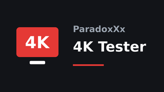

<p align="center">
  
</p>

<h1 align="center">ParadoxXx 4K Tester</h1>

<p align="center">
  <b>🇫🇷 <a href="#-français">Français</a></b> · <b>🇬🇧 <a href="#-english">English</a></b>
</p>

---

## 🇫🇷 Français

### C'est quoi ?
Une appli Android TV qui répond, **en langage simple**, à la question :
*« Qu'est-ce que mon boîtier sait vraiment lire, et ma connexion suit-elle ? »*

En 3 minutes environ, elle teste la Full HD, la 4K, le HDR10, le Dolby Vision,
la 8K et l'AV1, puis affiche un verdict compréhensible par tous.

### Ce qui est testé

| Catégorie | Tests |
|---|---|
| **Connexion** | Débit réel, type (Ethernet / Wi-Fi 2,4 / 5 GHz), vitesse du port Ethernet |
| **Full HD (1080p)** | H.264 · HEVC · HEVC 10 bits |
| **4K** | H.264 · HEVC · HEVC 10 bits · HEVC 10 bits haut débit (80 Mb/s) |
| **HDR** | HDR10 Full HD · HDR10 4K · Dolby Vision 4K (profil 8.1) |
| **8K** | HEVC |
| **AV1** | Full HD · 4K |

### Comment lire les résultats

| Icône | Signification |
|---|---|
| ✅ | Lecture parfaitement fluide |
| ⚠️ | OK pour les films et séries (24–30 i/s), limite pour le sport et les vidéos en 60 i/s |
| ➖ | Pas de Dolby Vision, mais la vidéo est lue en HDR10 à la place |
| 📶 | Connexion trop lente pour ce format (coupures pendant la lecture) |
| ❌ | Format non pris en charge, ou boîtier pas assez puissant |
| ❔ | Vidéo de test indisponible (serveur) |

L'appli distingue les deux causes de saccades :
**débit suffisant + saccades = boîtier trop faible**,
**coupures + débit insuffisant = connexion trop lente**.

Un avertissement s'affiche si la sortie HDMI est réglée en 24/25/30 Hz
(ex. « Auto » en 4K 30 Hz) : dans ce cas, réglez une résolution en 60 Hz
(ex. 1920x1080p60) et refaites le test.

### Rapport technique
Le bouton **« Rapport (log) »** affiche un rapport complet, avec un bouton **« Copier »** :
modèle, SoC, RAM, mode HDMI réel, firmware, débit, détail de chaque test
(décodeur matériel / logiciel, images par seconde affichées, images perdues, coupures)
et la liste de tous les décodeurs vidéo du boîtier.

Il est aussi enregistré ici :
```
adb pull /sdcard/Android/data/fr.paradoxxx.tester4k/files/paradoxxx-4k-log.txt
```
Avec scrcpy, le presse-papiers du boîtier est synchronisé avec le PC : « Copier » dans l'appli, puis Ctrl+V sur le PC.

### Installation
1. Téléchargez `ParadoxXx-4K-Tester.apk` dans les [Releases](../../releases).
2. Installez-le : `adb install ParadoxXx-4K-Tester.apk`, ou via un gestionnaire de fichiers / Downloader.
3. Lancez **ParadoxXx 4K Tester** depuis l'écran d'accueil Android TV.

**Compatibilité :** Android 5.0 et plus, toutes architectures (armv7, arm64, x86 :
l'appli ne contient aucune bibliothèque native). Navigation à la télécommande.
**Connexion Internet obligatoire.**

### Comment ça marche
1. **Débit** : ~7 s de téléchargement depuis `repo.jellyfin.org`.
2. **Sonde des décodeurs** (`MediaCodecList`) avant chaque vidéo : un format sans décodeur
   (ou une 8K refusée) est marqué ❌ immédiatement, sans rien télécharger.
3. **Lecture** de chaque vidéo pendant 10 s en streaming (ExoPlayer / Media3).
   Après 2 s de démarrage, l'appli mesure les images par seconde réellement affichées.
4. **Verdict** : ✅ si ≥ 92 % de la cadence de la vidéo, ⚠️ si ≥ 24 i/s, ❌ en dessous.

### Compiler soi-même
Le dépôt se compile avec **GitHub Actions** (`.github/workflows/build.yml`) :
chaque push lance le workflow **Build APK** ; l'APK se télécharge dans l'onglet
*Actions → run → Artifacts*.

**Signature :** si les secrets `KEYSTORE_BASE64`, `KEYSTORE_PASSWORD`, `KEY_ALIAS` et
`KEY_PASSWORD` sont définis (*Settings → Secrets and variables → Actions*), l'APK est signé
avec cette clé fixe et les mises à jour s'installent par-dessus. Sinon, une clé debug
temporaire est utilisée (désinstaller avant chaque mise à jour).

### Crédits
- Vidéos de test : **Jellyfin / Gnattu**, licence Creative Commons BY-SA.
- Lecteur : **AndroidX Media3 (ExoPlayer)**.
- Développé par **ParadoxXx Squad**.

---

## 🇬🇧 English

### What is it?
An Android TV app that answers, **in plain language**:
*"What can my box really play, and is my connection fast enough?"*

In about 3 minutes it tests Full HD, 4K, HDR10, Dolby Vision, 8K and AV1,
then shows a verdict anyone can understand.

### What is tested

| Category | Tests |
|---|---|
| **Connection** | Real speed, type (Ethernet / Wi-Fi 2.4 / 5 GHz), Ethernet port speed |
| **Full HD (1080p)** | H.264 · HEVC · HEVC 10-bit |
| **4K** | H.264 · HEVC · HEVC 10-bit · HEVC 10-bit high bitrate (80 Mb/s) |
| **HDR** | HDR10 Full HD · HDR10 4K · Dolby Vision 4K (profile 8.1) |
| **8K** | HEVC |
| **AV1** | Full HD · 4K |

### Reading the results

| Icon | Meaning |
|---|---|
| ✅ | Perfectly smooth playback |
| ⚠️ | Fine for movies and series (24–30 fps), borderline for sports and 60 fps videos |
| ➖ | No Dolby Vision, but the video plays as HDR10 instead |
| 📶 | Connection too slow for this format (buffering during playback) |
| ❌ | Format not supported, or box not powerful enough |
| ❔ | Test video unavailable (server) |

The app tells the two causes of stutter apart:
**enough bandwidth + stutter = box too weak**,
**buffering + not enough bandwidth = connection too slow**.

A warning is shown when the HDMI output runs at 24/25/30 Hz
(e.g. "Auto" picking 4K 30 Hz): set a 60 Hz resolution
(e.g. 1920x1080p60) and run the test again.

### Technical report
The **"Rapport (log)"** button shows a full report with a **"Copy"** button:
model, SoC, RAM, real HDMI mode, firmware, speed, per-test details
(hardware / software decoder, frames per second actually displayed, dropped frames, buffering)
and the list of every video decoder on the box.

It is also saved here:
```
adb pull /sdcard/Android/data/fr.paradoxxx.tester4k/files/paradoxxx-4k-log.txt
```
With scrcpy, the box clipboard is synced to the PC: "Copy" in the app, then Ctrl+V on the PC.

### Installation
1. Download `ParadoxXx-4K-Tester.apk` from [Releases](../../releases).
2. Install it: `adb install ParadoxXx-4K-Tester.apk`, or with a file manager / Downloader.
3. Launch **ParadoxXx 4K Tester** from the Android TV home screen.

**Compatibility:** Android 5.0+, any architecture (armv7, arm64, x86:
the app ships no native library). Remote-control friendly.
**Internet connection required.**

> The interface is currently in French only.

### How it works
1. **Speed**: ~7 s download from `repo.jellyfin.org`.
2. **Decoder probe** (`MediaCodecList`) before each video: a format with no decoder
   (or a refused 8K) is marked ❌ instantly, without downloading anything.
3. **Playback** of each video for 10 s, streamed (ExoPlayer / Media3).
   After a 2 s warm-up, the app measures the frames per second actually displayed.
4. **Verdict**: ✅ if ≥ 92 % of the video frame rate, ⚠️ if ≥ 24 fps, ❌ below.

### Building
The repo builds with **GitHub Actions** (`.github/workflows/build.yml`):
every push runs the **Build APK** workflow; grab the APK from
*Actions → run → Artifacts*.

**Signing:** if the `KEYSTORE_BASE64`, `KEYSTORE_PASSWORD`, `KEY_ALIAS` and `KEY_PASSWORD`
secrets are set (*Settings → Secrets and variables → Actions*), the APK is signed with that
fixed key and updates install over the previous version. Otherwise a temporary debug key
is used (uninstall before each update).

### Credits
- Test videos: **Jellyfin / Gnattu**, Creative Commons BY-SA license.
- Player: **AndroidX Media3 (ExoPlayer)**.
- Made by **ParadoxXx Squad**.
